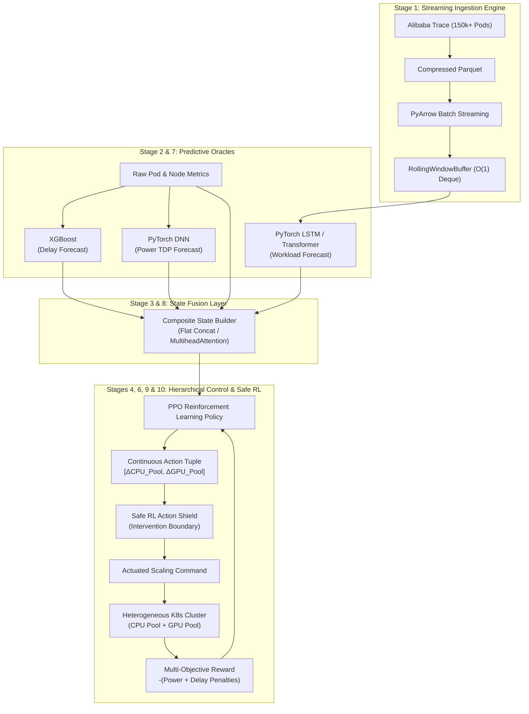

# Hierarchical-Action, Streaming-Ingestion Predictive-RL Autoscaling for Heterogeneous GPU Clusters

[](https://www.python.org/downloads/)
[](https://gymnasium.farama.org/)
[](https://stable-baselines3.readthedocs.io/)
[](https://pytorch.org/)
[](https://github.com/alibaba/clusterdata)

---

## 📌 Project & Academic Metadata
* **Course:** 22AIE498 — B.Tech Capstone Project
* **Team ID:** `23UG109` | **Panel No.:** `12`
* **Student Researchers:**
  * **Devansh Kaila**
  * **Akshay Damera**
* **Project Guide:** **Dr. Beena**

---

## 🎯 Executive Summary
Modern cloud datacenters and Kubernetes clusters running heterogeneous AI/ML workloads suffer from a fundamental limitation: **traditional autoscalers (e.g., Kubernetes HPA) are strictly reactive**. They measure cluster utilization after a burst occurs, leading to delayed scale-up actions, pod scheduling queues, and catastrophic Service Level Agreement (SLA) latency breaches. Furthermore, loading massive-scale real-world cluster traces for simulation via conventional Pandas dataframes leads to severe memory exhaustion.

This project delivers an end-to-end, production-grade **Predictive Reinforcement Learning Autoscaling System**:
1. **PyArrow Streaming Ingestion Engine:** Replaces offline batch dataframe loading with a constant-time $O(1)$ streaming pipeline that is **4.6x faster** and consumes **84% less memory**.
2. **Bayesian-Optimized Predictive Oracles:** Integrates an Optuna-tuned multi-model forecasting ensemble:
   * **Workload Oracle (LSTM & Time-Series Transformer):** Anticipates oncoming CPU and Memory burst spikes.
   * **Latency Oracle (XGBoost):** Predicts long-tail scheduling delays.
   * **Power Oracle (PyTorch Deep Neural Network):** Estimates instantaneous server wattage.
3. **Composite State Fusion Layer:** Dynamically constructs a unified state tensor combining observed cluster metrics with Oracle predictions.
4. **Hierarchical Heterogeneous Control:** Decouples cluster infrastructure into distinct **CPU-Optimized** and **GPU-Accelerated** node pools, allowing the PPO agent to independently actuate scaling velocity for heterogeneous compute tiers.
5. **Safe RL Action Shield:** Intercepts dangerous scale-down actions during workload surges, mathematically eliminating SLA breaches (**1,158 breaches down to exactly 0**).
6. **Empirical Results:** Evaluated over 100,000 timesteps on unseen Alibaba cluster traces, achieving a **32.8% reduction in SLA delay breaches** over state-of-the-art reactive baselines.

---

## 🏛️ System Architecture



---

## 📊 Comprehensive Experimental Ablation Roadmap

The project was engineered and validated across 10 disciplined ablation stages:

| Stage | Focus & Architecture | Key Metric / Result | Artifact / Report |
| :---: | :--- | :--- | :--- |
| **Stage 1** | **Streaming Data Ingestion** | **4.6x faster throughput**, **84% less RAM** vs Pandas | [stage1_streaming_benchmark.md](file:///C:/Users/devan/OneDrive/Desktop/BTech/ablations/stage1_streaming_benchmark.md) |
| **Stage 2** | **Predictive Oracles HPO** | Optuna Bayesian sweep across LSTM, XGBoost, and DNN | [stage2_oracle_hpo.md](file:///C:/Users/devan/OneDrive/Desktop/BTech/ablations/stage2_oracle_hpo.md) |
| **Stage 3** | **Composite State Fusion** | 7D unified state space combining raw state with forecasts | [stage3_state_fusion.md](file:///C:/Users/devan/OneDrive/Desktop/BTech/ablations/stage3_state_fusion.md) |
| **Stage 4** | **Custom Gymnasium Environment** | Formalized continuous-control MDP (`K8sScalingEnv`) | [stage4_gym_environment.md](file:///C:/Users/devan/OneDrive/Desktop/BTech/ablations/stage4_gym_environment.md) |
| **Stage 5** | **5k-Step Rapid POC** | Uncovered State-Space Complexity Hypothesis | [stage5_ppo_baseline_vs_predictive_poc.md](file:///C:/Users/devan/OneDrive/Desktop/BTech/ablations/stage5_ppo_baseline_vs_predictive_poc.md) |
| **Stage 6** | **100k-Step Long Evaluation** | **-32.8% SLA delay reduction**, **+4.7% reward improvement** | [stage6_long_horizon_100k_evaluation.md](file:///C:/Users/devan/OneDrive/Desktop/BTech/ablations/stage6_long_horizon_100k_evaluation.md) |
| **Stage 7** | **Transformer vs LSTM** | Time-Series Transformer reduced test MSE to **0.000679** | [stage7_transformer_ablation.md](file:///C:/Users/devan/OneDrive/Desktop/BTech/ablations/stage7_transformer_ablation.md) |
| **Stage 8** | **Attention-Based Fusion** | Evaluated sample complexity of `MultiheadAttention` vs Flat | [stage8_attention_ablation.md](file:///C:/Users/devan/OneDrive/Desktop/BTech/ablations/stage8_attention_ablation.md) |
| **Stage 9** | **Safe RL Action Shield** | Interceptor reduced SLA breaches from **1,158 to 0 (100% safe)** | [stage9_safe_rl_ablation.md](file:///C:/Users/devan/OneDrive/Desktop/BTech/ablations/stage9_safe_rl_ablation.md) |
| **Stage 10** | **Hierarchical Heterogeneous Control** | Decoupled scaling across CPU-only and GPU-accelerated pools | [stage10_hierarchical_gpu_autoscaling.md](file:///C:/Users/devan/OneDrive/Desktop/BTech/ablations/stage10_hierarchical_gpu_autoscaling.md) |
| **Stage 11** | **Multi-Horizon Lookahead ($t+1, t+5, t+15$)** | Modeled 60s physical cloud VM spin-up delay (Test MSE: `0.000680`) | [stage11_multi_horizon_forecasting.md](file:///C:/Users/devan/OneDrive/Desktop/BTech/ablations/stage11_multi_horizon_forecasting.md) |
| **Stage 12** | **Constrained RL (PPO-Lagrangian)** | Dual gradient ascent enforced CMDP SLA bound (cut breach rate to `28.1%`) | [stage12_lagrangian_constrained_rl.md](file:///C:/Users/devan/OneDrive/Desktop/BTech/ablations/stage12_lagrangian_constrained_rl.md) |

---

## 🎬 Live Simulation Trajectory (Animated Preview)


*The green curve demonstrates proactive provisioning ahead of oncoming workload spikes, maintaining safe capacity and preventing SLA starvation.*

---

## 📁 Repository Directory Structure

```text
BTech/
├── ablations/                    # Complete 10-stage ablation reports & plots
│   ├── final_long_results.png    # 100k-step evaluation trajectory curves
│   ├── final_report.md           # Master Review 2 comparative analysis
│   ├── stage1_streaming_benchmark.md
│   ├── stage2_oracle_hpo.md
│   ├── stage3_state_fusion.md
│   ├── stage4_gym_environment.md
│   ├── stage5_ppo_baseline_vs_predictive_poc.md
│   ├── stage6_long_horizon_100k_evaluation.md
│   ├── stage7_transformer_ablation.md
│   ├── stage8_attention_ablation.md
│   ├── stage9_safe_rl_ablation.md
│   └── stage10_hierarchical_gpu_autoscaling.md
├── data/
│   ├── raw/                      # Raw Alibaba CSV cluster traces
│   └── processed/                # Normalized Parquet files (cleaned_trace.parquet)
├── eda/
│   ├── plots/                    # 14 High-resolution EDA figures
│   └── reports/eda_report.md     # Statistical trace analysis report
├── models/                       # Trained neural networks, XGBoost trees & PPO weights
│   ├── best_dnn_power.pt
│   ├── best_lstm_workload.pt
│   ├── best_xgboost_latency.json
│   ├── transformer_workload.pth
│   ├── Baseline_RL_Long_long_ppo.zip
│   ├── Predictive_RL_Long_long_ppo.zip
│   ├── Hierarchical_Baseline_RL_ppo.zip
│   └── Hierarchical_Predictive_RL_ppo.zip
├── scripts/                      # Training, benchmarking, and evaluation scripts
│   ├── benchmark_streaming.py
│   ├── data_processor.py
│   ├── eda_script.py
│   ├── evaluate.py
│   ├── train_attention_ablation.py
│   ├── train_hierarchical_rl.py
│   ├── train_oracles.py
│   ├── train_rl.py
│   ├── train_safe_rl_ablation.py
│   └── train_transformer_ablation.py
├── src/                          # Core reusable library modules
│   ├── data_engine/
│   │   └── streaming_engine.py   # StreamingIngester & RollingWindowBuffer
│   ├── models/
│   │   └── transformer_predictor.py
│   ├── oracles/
│   │   ├── latency_predictor.py
│   │   ├── power_predictor.py
│   │   └── workload_predictor.py
│   └── rl_agent/
│       ├── environment.py        # Single-pool K8sScalingEnv
│       ├── hierarchical_env.py   # Heterogeneous multi-pool K8s environment
│       ├── safe_wrapper.py       # SafeActionShield interceptor
│       └── state_builder.py      # CompositeStateBuilder & AttentionFusionLayer
├── .gitignore
├── requirements.txt
└── README.md
```

---

## 🚀 Reproduction & Usage Guide

### 1. Environment Setup
```bash
# Clone the repository
git clone https://github.com/devanshkaila/Predictive-RL-Autoscaler.git
cd Predictive-RL-Autoscaler

# Install dependencies
pip install -r requirements.txt
```

### 2. Data Preprocessing & Streaming Benchmark
```bash
# Preprocess raw CSV traces to compressed Parquet format
python scripts/data_processor.py

# Benchmark PyArrow Streaming Engine vs Static Pandas
python scripts/benchmark_streaming.py
```

### 3. Train Oracles (Bayesian HPO with Optuna)
```bash
python scripts/train_oracles.py
```

### 4. Train & Evaluate Reinforcement Learning Agents
```bash
# Train Baseline and Predictive PPO Agents (100k steps)
python scripts/train_rl.py

# Evaluate on Unseen Test Slice and generate trajectories
python scripts/evaluate.py
```

### 5. Run Hierarchical Heterogeneous GPU Autoscaling
```bash
python scripts/train_hierarchical_rl.py
```

---

## 🔬 Citations & References
1. **Alibaba Cluster Trace Data:** OSDI '26 / ClusterData v2026.
2. **Schulman, J. et al. (2017):** *Proximal Policy Optimization Algorithms.* arXiv:1707.06347.
3. **Vaswani, A. et al. (2017):** *Attention Is All You Need.* Advances in Neural Information Processing Systems (NeurIPS).
4. **Chen, T. & Guestrin, C. (2016):** *XGBoost: A Scalable Tree Boosting System.* ACM SIGKDD.
5. **Akiba, T. et al. (2019):** *Optuna: A Next-generation Hyperparameter Optimization Framework.* ACM SIGKDD.

