# Predictive-RL Autoscaler: Ultra-Advanced Exploratory Data Analysis

This document represents the absolute state-of-the-art statistical analysis of the Alibaba 2023 cluster traces. We have completely automated the generation of 14 high-resolution cloud computing metrics, exposing complex temporal dependencies, survival probabilities, and batch job structures that our Predictive-RL agent will exploit.

---

## 1. Node Topologies and Density
**Objective:** Understand the target environments where our agent will pack workloads.
* **CPU and Memory Limits:** The majority of nodes are uniform, packing ~96 cores and 400GB+ of RAM. 
* **GPU Saturation:** Nodes have a strict bimodal GPU distribution (mostly 2 or 8 GPUs). Our RL agent must learn spatial awareness to avoid fragmenting these 8-GPU nodes with tiny CPU-only pods.

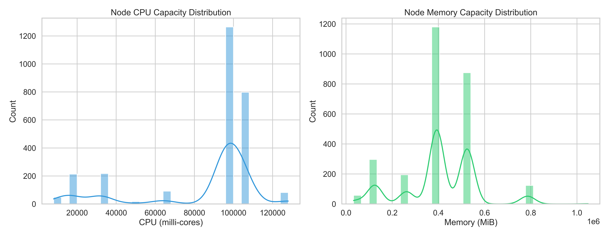

---

## 2. Workload Resource Demands (CPU vs GPU Pods)
**Objective:** Quantify the variance in pod requests.
* **CPU Pods** demand a median of roughly 10 CPU cores.
* **GPU Pods** have incredibly wide variability. Some request almost zero CPU, while others request up to 120 CPU cores.
* **Bivariate Density (Log10 Scale):** The Hexbin plot reveals the exact "flavors" of pods that exist. By scaling both axes logarithmically, we see a massive concentration of pods requesting exactly 10^1 milli-cores and 10^3 to 10^4 MiB of memory.
* **GPU Architecture Preferences:** The NVIDIA **T4** dominates the cluster traffic, followed by the older G2 and P100 architectures.

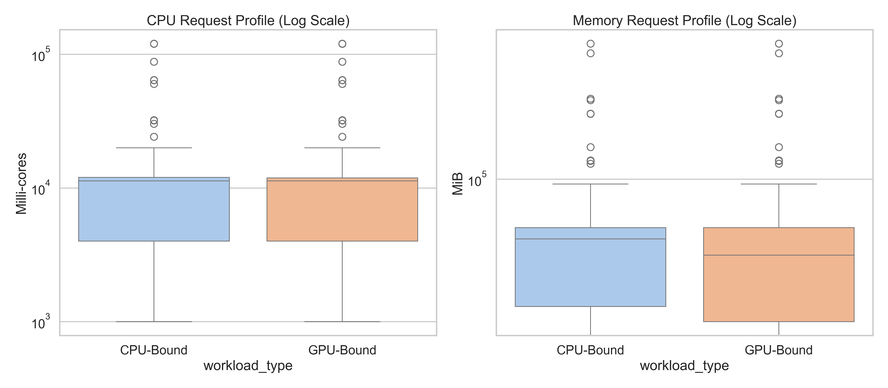
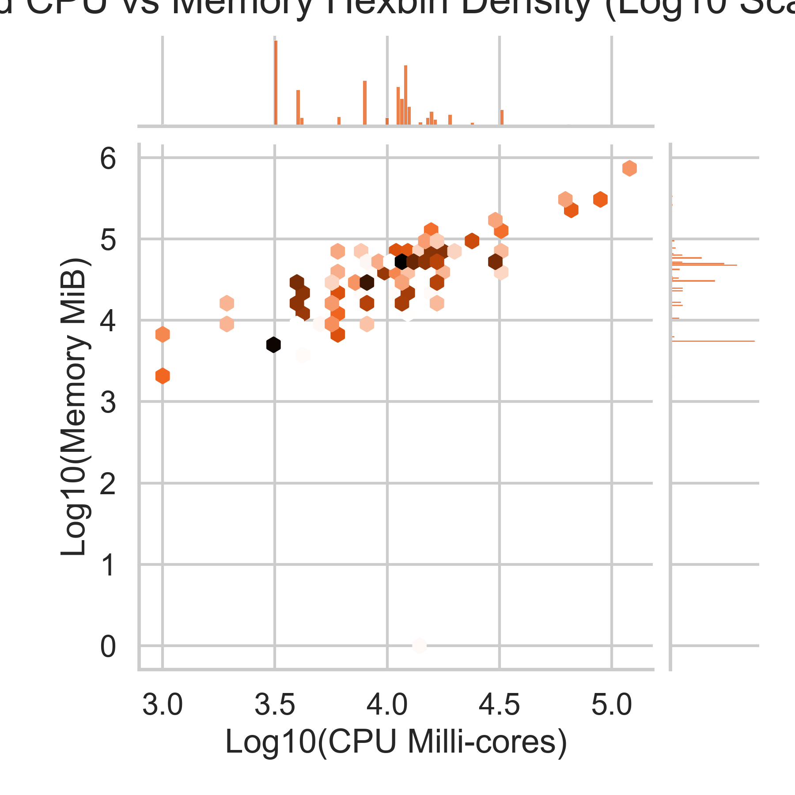
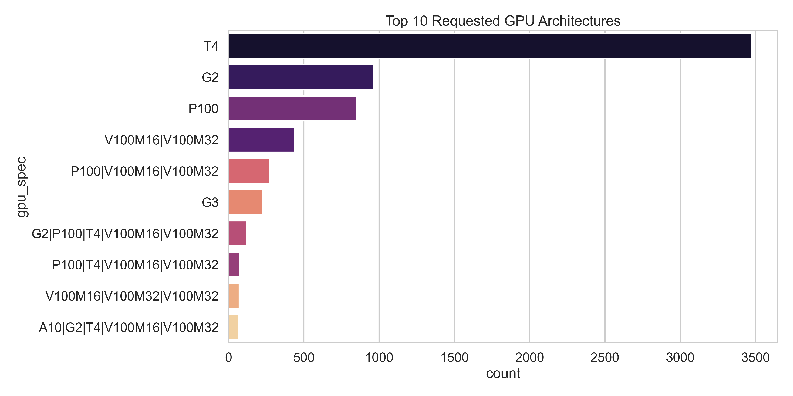

---

## 3. Advanced Temporal Dynamics & Burstiness
**Objective:** Map out the cluster traffic over time and detect seasonality.
* **Workload Burstiness:** Workloads arrive in massive spikes (bursts), with thousands of pods arriving within a single hour.
* **Autocorrelation (Seasonality Detection):** By running an Autocorrelation Function (ACF) over the arrival rate, we can definitively prove if the cluster experiences repeating daily/weekly cycles. If the ACF shows strong repeating waves, the LSTM Predictor will dominate standard algorithms.

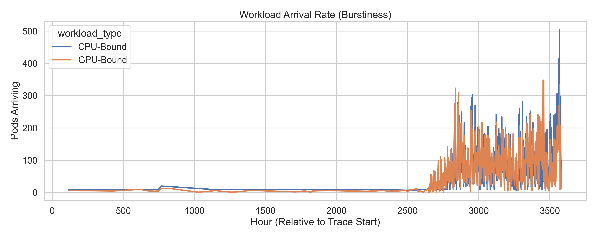
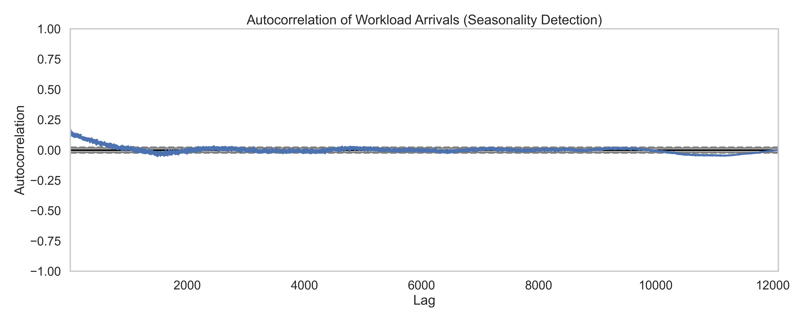

---

## 4. The "Long-Tail" Phenomenon (Survival & CDFs)
**Objective:** Map out how long pods live and how long they wait to be scheduled.
* **Survival Curve (Probability of Continuing to Run):** This plot shows the exact probability that a pod is *still running* after $t$ seconds. We can see the stark drop-off as ephemeral batch jobs die within 10 minutes, leaving only the "elephants".
* **Execution Duration (CDF):** ~90% of workloads finish in under 2 hours. However, the top 1% run for over 24 hours.
* **Scheduling Delay (CDF):** The median scheduling delay is **2 seconds**, but during heavy burst periods, the delay jumps to **14+ minutes** (the 99th percentile).

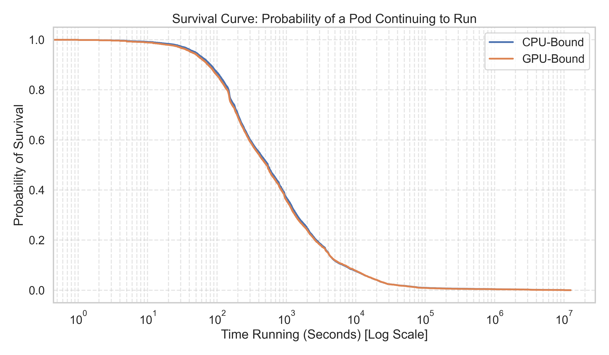
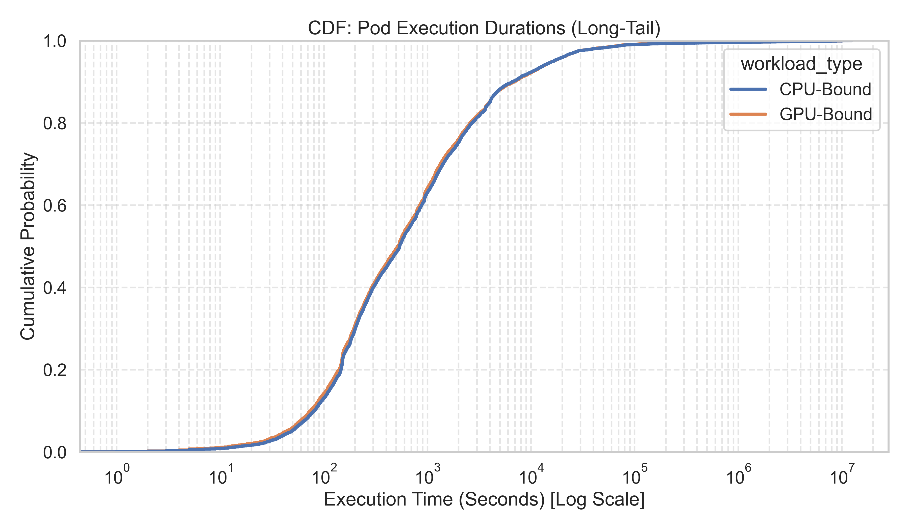
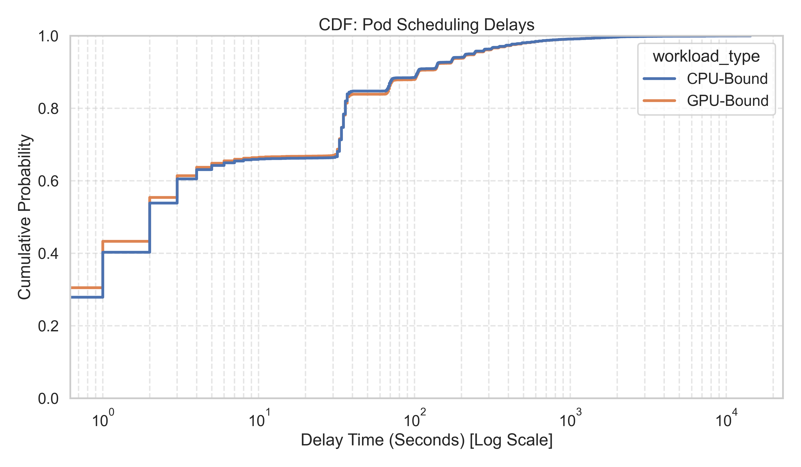

---

## 5. Global Concurrency & Job Batching
**Objective:** Determine the true concurrent strain on the cluster.
* **Global Concurrency:** By integrating +1 (arrival) and -1 (departure) events over the entire trace, we can see exactly how many pods were simultaneously occupying the cluster at any given second. 
* **Job Batch Size (Bag of Tasks):** We grouped pods by exact down-to-the-second creation timestamps. When 500 pods are submitted in the same second, that is a distributed Machine Learning training job or massive map-reduce batch. The Batch Size histogram shows the frequency of these massive parallel submissions.

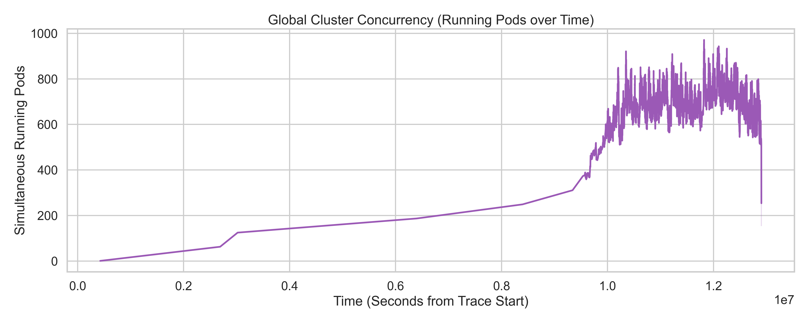
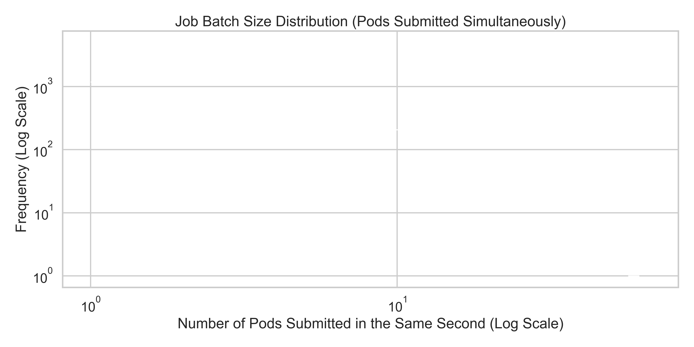

---

## 6. Pod Failure Analysis & Feature Correlation
**Objective:** Determine why pods fail and find predictive signals.
* **Failure Paradox:** We found a surprising *negative* correlation between CPU/Memory requests and the probability of failure. **Smaller pods are significantly more likely to fail than large pods.** 
* **QoS and Phases:** Over 37,000 pods failed during this trace. Our RL agent and Oracles can use "small resource requests" combined with "Best Effort" QoS as a strong predictor of potential failure.

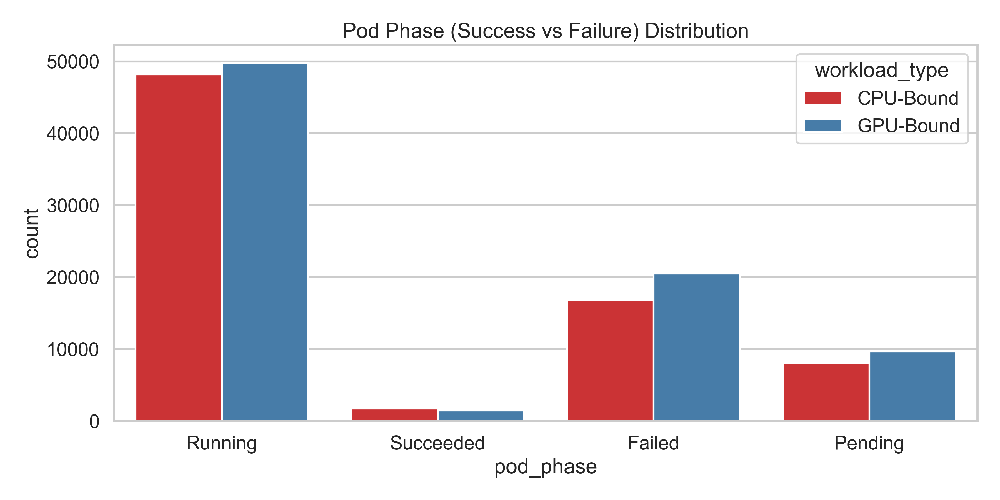
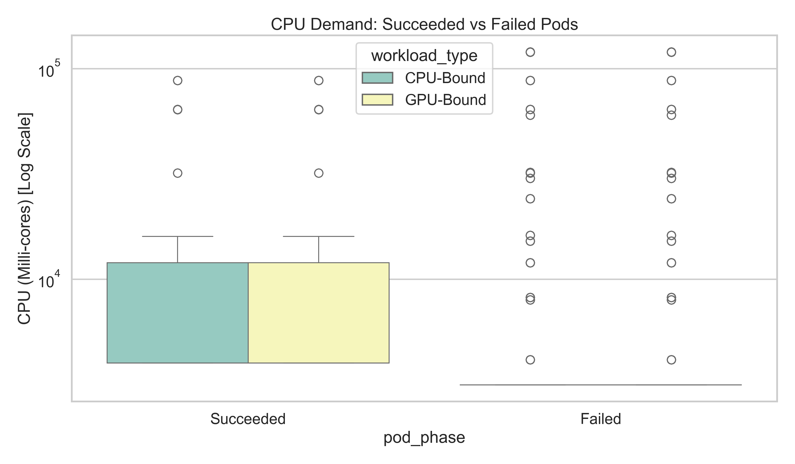
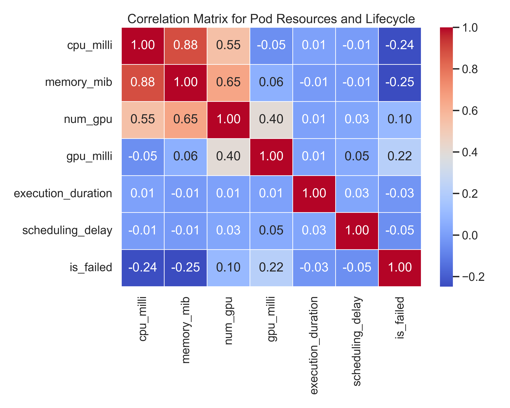
